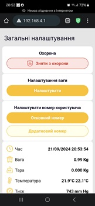
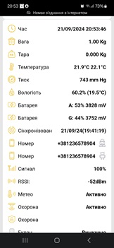
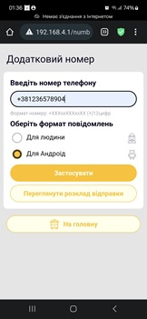
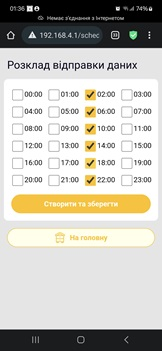

Language: [English](README.md) | [Українська](readme.uk.md) | [Deutsch](readme.de.md)

### Important

Compatible only with BLE 2.0 boards or boards upgraded separately by a service center. The planned market launch is autumn 2026.

 - build-de version : 4.9.5ca72b9-de

 - build-en version : 4.9.5ca72b9-en

 - build-es version : 4.9.5ca72b9-es

 - build-fr version : 4.9.5ca72b9-fr

 - build-pl version : 4.9.5ca72b9-pl

 - build-uk version : 4.9.5ca72b9-uk

### How to update the firmware

1. Copy the `apiary.bin` file to the `/fm` folder on the device's microSD card (create the folder if it does not exist).
2. Reinsert the microSD card into the device and restart it.
3. Wait 1–2 minutes for the device to turn itself off (the indicator LEDs will stop blinking).
4. Start the device again, reconnect to it, and check the new software version on the home page. The current versions are listed below.

### Languages

Select the interface language by installing the corresponding firmware version:

- English: [En](build-en/apiary.bin)
- Українська (Ukrainian): [Uk](build-uk/apiary.bin)
- Polski (Polish): [Pl](build-pl/apiary.bin)
- Deutsch (German): [De](build-de/apiary.bin)
- Español (Spanish): [Es](build-es/apiary.bin)
- Français (French): [Fr](build-fr/apiary.bin)

You can request a translation into another language (conditionally free of charge).

Firmware for different languages can be compared by release date. The hash (the characters after the version number) may differ between localizations.

### Video guides

[BeeApiary YouTube channel](https://www.youtube.com/@BeeApiary)

### Current versions

Many features have been added to support devices over BLE.

### Web interface

   

Special thanks to UI/UX designer Oleksandr Yatsiuk for his excellent professional help in creating a design for a small, resource-constrained embedded device.

### Device concept

The project's goal is to create a protected outdoor measuring device for an apiary that does not require regular physical access. It only needs to be opened once to install the SIM card.

Measurements and device settings are available through a web interface without requiring an internet connection. When necessary, log and measurement files can be downloaded from the device over Wi-Fi without opening the enclosure. This reduces the risk of weather-related damage and extends the device's service life.

Measurements are transferred automatically and directly to an Android device; they are not stored on a server or in the cloud. The device can use internet access for synchronization, but only when the user chooses to do so. This prevents information, including technical data, from being collected for third parties. At this stage, synchronization is an optional feature and does not affect the device's core functions.

### Next-generation Hive Controller

The updated version will retain the best features of the previous device while adding many new capabilities.

Version: `4.9.XXXXXX`

- The new device range will support all major data-transfer methods: GSM, Wi-Fi, and BLE.
- GSM will transfer data over the mobile network exclusively via SMS, providing high reliability and resilience in areas with weak reception.
- Data will be available locally over Wi-Fi, independently of the mobile operator and without a SIM card.
- Data transfer over a local apiary network and relay to anywhere in the world will be supported. The network will act as a tunnel between the device and the phone; no data will be stored on a server.
- Local BLE transfer will provide instant data on a phone or a separate display capable of operating for more than a year on a single charge.
- External BLE sensors, including devices from other manufacturers, will be supported.
- An e-Ink display can serve as an apiary data collector. It will show data from any number of devices and remain informative even without a phone.
- GPS positioning data will be available as an optional feature.
