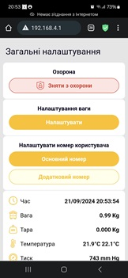
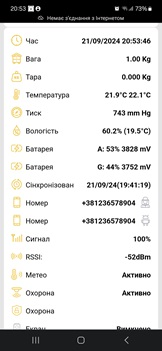
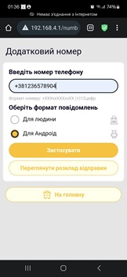
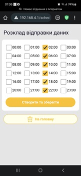

Sprache: [English](README.md) | [Українська](readme.uk.md) | [Deutsch](readme.de.md)

### Wichtig

Nur mit BLE-2.0-Platinen oder separat von einem Servicezentrum aktualisierten Platinen kompatibel. Die Markteinführung ist für Herbst 2026 geplant.

### Firmware aktualisieren

1. Die Datei `apiary.bin` in den Ordner `/fm` auf der microSD-Karte des Geräts kopieren (den Ordner anlegen, falls er nicht vorhanden ist).
2. Die microSD-Karte wieder in das Gerät einsetzen und das Gerät neu starten.
3. 1–2 Minuten warten, bis sich das Gerät selbstständig ausschaltet (die LEDs hören auf zu blinken).
4. Das Gerät erneut einschalten, die Verbindung wiederherstellen und die neue Softwareversion auf der Startseite prüfen. Die aktuellen Versionen sind unten aufgeführt.

### Sprachen

Die Sprache der Benutzeroberfläche wird durch Installation der entsprechenden Firmwareversion ausgewählt:

- English: [En](build-en/apiary.bin)
- Українська (Ukrainian): [Uk](build-uk/apiary.bin)
- Polski (Polish): [Pl](build-pl/apiary.bin)
- Deutsch (German): [De](build-de/apiary.bin)
- Español (Spanish): [Es](build-es/apiary.bin)
- Français (French): [Fr](build-fr/apiary.bin)

Eine Übersetzung in eine weitere Sprache kann angefragt werden (unter bestimmten Bedingungen kostenlos).

Firmwareversionen für verschiedene Sprachen können anhand des Veröffentlichungsdatums verglichen werden. Der Hash (die Zeichen nach der Versionsnummer) kann je nach Lokalisierung abweichen.

### Videoanleitungen

[BeeApiary auf YouTube](https://www.youtube.com/@BeeApiary)

### Aktuelle Versionen

Zahlreiche Funktionen zur Unterstützung von Geräten über BLE wurden hinzugefügt.

### Weboberfläche

   

Ein besonderer Dank gilt dem UI/UX-Designer Oleksandr Yatsiuk für seine hervorragende professionelle Unterstützung bei der Gestaltung eines kleinen Embedded-Geräts mit begrenzten Ressourcen.

### Gerätekonzept

Ziel des Projekts ist die Entwicklung eines geschützten Messgeräts für den Außeneinsatz auf einem Bienenstand, das keinen regelmäßigen physischen Zugriff erfordert. Es muss nur einmal zum Einsetzen der SIM-Karte geöffnet werden.

Messwerte und Geräteeinstellungen sind über eine Weboberfläche zugänglich, ohne dass eine Internetverbindung erforderlich ist. Bei Bedarf können Protokoll- und Messdateien über Wi-Fi vom Gerät heruntergeladen werden, ohne das Gehäuse zu öffnen. Dadurch sinkt das Risiko witterungsbedingter Schäden und die Lebensdauer des Geräts wird verlängert.

Die Messwerte werden automatisch und direkt an ein Android-Gerät übertragen; sie werden weder auf einem Server noch in der Cloud gespeichert. Für die Synchronisierung kann das Gerät auf Wunsch des Benutzers eine Internetverbindung verwenden. Damit wird verhindert, dass Informationen – einschließlich technischer Daten – für Dritte gesammelt werden. Die Synchronisierung ist derzeit eine optionale Funktion und hat keinen Einfluss auf die Kernfunktionen des Geräts.

### Hive Controller der nächsten Generation

Die aktualisierte Version wird die besten Eigenschaften des bisherigen Geräts beibehalten und zugleich zahlreiche neue Funktionen erhalten.

Version: `4.9.XXXXXX`

- Die neue Gerätegeneration wird alle wichtigen Verfahren zur Datenübertragung unterstützen: GSM, Wi-Fi und BLE.
- Über GSM werden Daten ausschließlich per SMS durch das Mobilfunknetz übertragen. Dies sorgt für hohe Zuverlässigkeit und Stabilität bei schwachem Empfang.
- Daten können lokal über Wi-Fi abgerufen werden – unabhängig vom Mobilfunkanbieter und ohne SIM-Karte.
- Die Übertragung über ein lokales Netzwerk am Bienenstand sowie die Weiterleitung an jeden Ort der Welt werden unterstützt. Das Netzwerk dient als Tunnel zwischen Gerät und Telefon; auf einem Server werden keine Daten gespeichert.
- Die lokale Übertragung per BLE ermöglicht den sofortigen Empfang der Daten auf einem Telefon oder einem separaten Display, das mit einer Akkuladung länger als ein Jahr betrieben werden kann.
- Externe BLE-Sensoren, einschließlich Geräten anderer Hersteller, können in das System eingebunden werden.
- Ein e-Ink-Display kann als Datensammler am Bienenstand eingesetzt werden. Es zeigt Daten einer beliebigen Anzahl von Geräten an und bleibt auch ohne Telefon informativ.
- GPS-Positionsdaten werden optional verfügbar sein.
