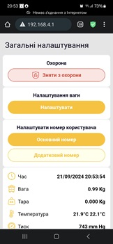
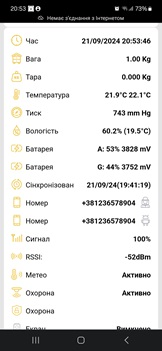
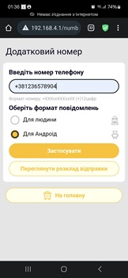
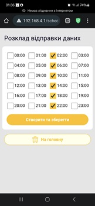

Мова: [English](README.md) | [Українська](readme.uk.md) | [Deutsch](readme.de.md)

### Увага

Сумісне лише з платами BLE 2.0 або окремо оновленими в сервісному центрі платами. Запланований вихід на ринок — осінь 2026 року.

### Як оновити прошивку?

1. Скопіюйте файл `apiary.bin` на карту microSD пристрою до папки `/fm` (якщо папки немає, створіть її).
2. Вставте карту microSD назад у пристрій і перезапустіть його.
3. Зачекайте 1–2 хвилини, доки пристрій самостійно не вимкнеться (індикатори перестануть блимати).
4. Знову запустіть пристрій, під'єднайтеся до нього та перевірте версію нового ПЗ на головній сторінці. Актуальні версії наведено нижче.

### Мови

Мову інтерфейсу можна вибрати, установивши відповідну версію прошивки:

- English: [En](build-en/apiary.bin)
- Українська (Ukrainian): [Uk](build-uk/apiary.bin)
- Polski (Polish): [Pl](build-pl/apiary.bin)
- Deutsch (German): [De](build-de/apiary.bin)
- Español (Spanish): [Es](build-es/apiary.bin)
- Français (French): [Fr](build-fr/apiary.bin)

Переклад іншою мовою можна замовити (умовно безкоштовно).

Версії для різних мов можна порівнювати за датою випуску. Хеш (символи після номера версії) у різних локалізаціях може відрізнятися.

### Відеоінструкції

[YouTube-канал BeeApiary](https://www.youtube.com/@BeeApiary)

### Актуальні версії

Додано багато функцій для підтримки пристроїв через BLE.

### Вебінтерфейс

   

Щиро дякую UI/UX-дизайнеру Олександру Яцюку за чудову професійну допомогу в розробленні дизайну для невеликого пристрою з обмеженими ресурсами вбудованої системи.

### Концепція пристрою

Мета проєкту — створити захищений вимірювальний пристрій для використання просто неба на пасіці, який не потребує регулярного фізичного втручання. Відкрити його потрібно лише один раз — для встановлення SIM-картки.

Результати вимірювань і налаштування пристрою доступні через вебінтерфейс, причому під'єднання до інтернету не потрібне. За потреби файли журналів і вимірювань можна завантажити з пристрою через Wi-Fi, не відкриваючи корпус. Це зменшує ризик пошкодження через погодні умови та подовжує строк експлуатації пристрою.

Результати вимірювань автоматично передаються безпосередньо на Android-пристрій і не зберігаються на сервері чи в хмарі. Для синхронізації пристрій може використовувати інтернет, але лише за бажанням користувача. Це унеможливлює збирання інформації, навіть технічної, на користь третіх осіб. На цьому етапі синхронізація є додатковою можливістю й не впливає на основні функції пристрою.

### Наступне покоління Hive Controller

Оновлена версія збереже всі найкращі риси попереднього пристрою та отримає багато нових функцій.

Версія: `4.9.XXXXXX`

- Новий модельний ряд пристроїв підтримуватиме передавання даних усіма основними способами: GSM, Wi-Fi та BLE.
- GSM забезпечуватиме передавання даних через мобільну мережу виключно за допомогою SMS, що дає високу надійність і стійкість за слабкого сигналу.
- Дані можна буде отримувати локально через Wi-Fi — незалежно від мобільного оператора й без SIM-картки.
- Підтримуватиметься передавання даних через локальну мережу на пасіці та їх ретрансляція в будь-яку точку світу. Мережа працюватиме як тунель між пристроєм і телефоном; дані не зберігатимуться на сервері.
- Локальне передавання через BLE забезпечуватиме миттєве отримання даних на телефоні або окремому екрані, здатному працювати понад рік від одного заряду.
- До системи можна буде під'єднувати зовнішні BLE-датчики, зокрема пристрої інших виробників.
- Екран e-Ink можна буде використовувати як пристрій збирання даних на пасіці. Він відображатиме дані з будь-якої кількості пристроїв і залишатиметься інформативним навіть без телефона.
- Як додаткову опцію можна буде отримувати дані GPS-позиціювання.
